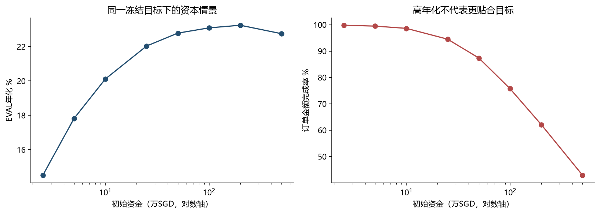
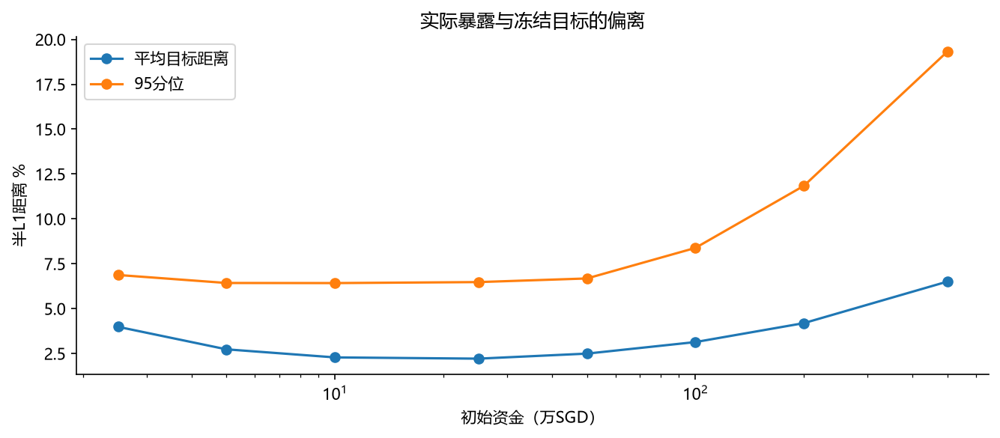
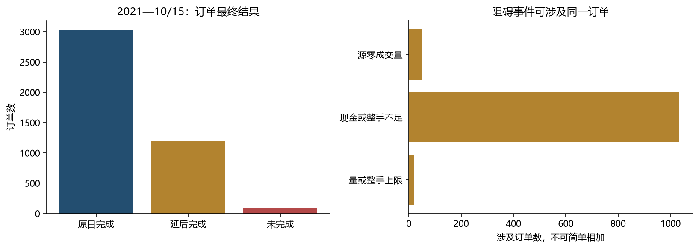
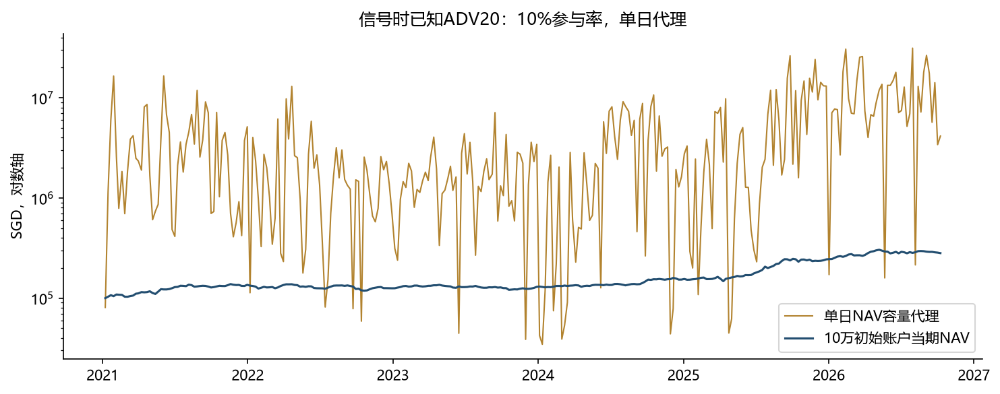
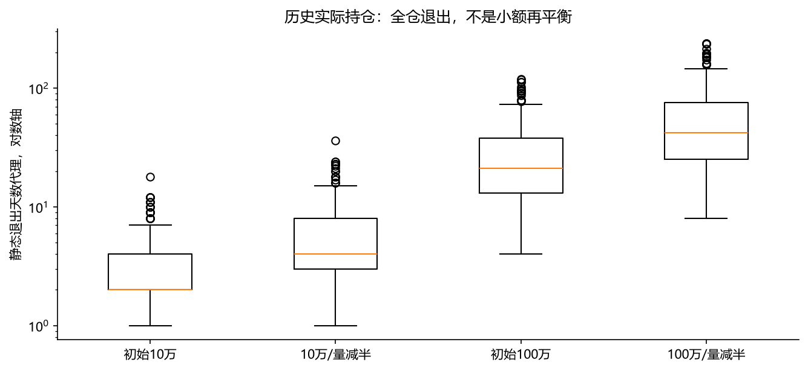
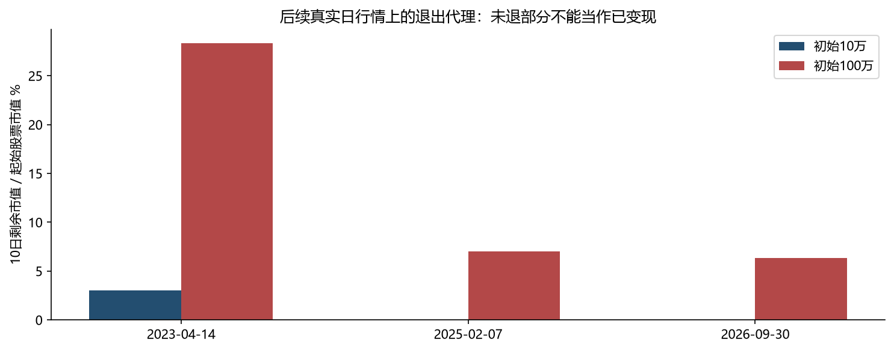
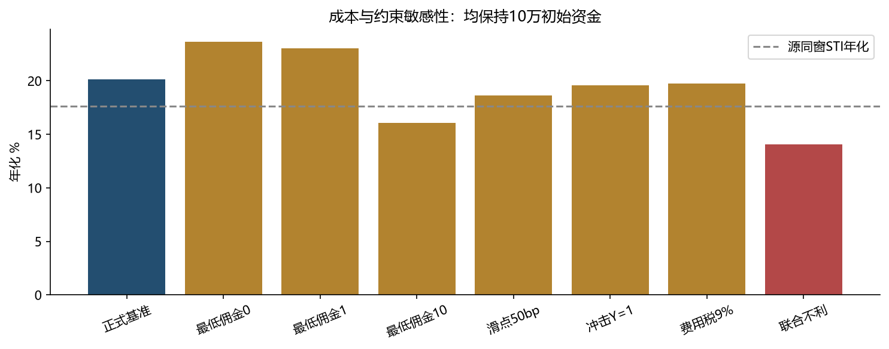
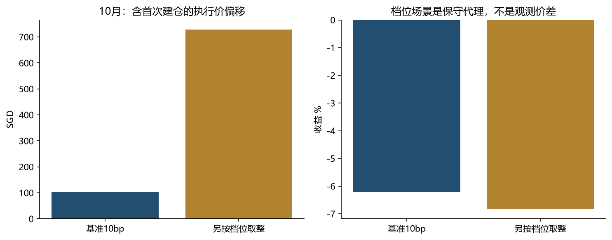

# 最终三因子策略 Investability

2026-10-21　K3 / IV weekly / top20　金额：SGD　基准资金：100,000

## 一、结论与适用范围

本次只研究最终的**K3／IV每周调权／前20%**。正式基准仍为初始100,000新币、源分红除权后14日到账。旧Investability的数值不直接沿用。

结论：10万基准在当前日频执行模型下可复现、能完成大部分调仓，但最低佣金、价格档位与退出尾部风险仍重要。现有数据无法认证盘口成交、收盘集合竞价容量或实盘市场冲击，不能把模型结果写成实盘成交保证。

完成46条冻结目标执行情景、2条实际持仓反馈情景、12条历史快照退出路径。正式基准逐日NAV与原回测完全一致。没有改动原策略、配置、输入数据或原回测入口。

历史EVAL：2021年初至2026-09-30；另报2026-10-01收盘至10-15的连续账户及10月重新建仓账户。完整账户流水至10-15；下文4316笔订单等全路径统计包含10月，EVAL收益及容量对照均单独标明。

## 二、资金增大以后发生了什么



| 初始资金 SGD | 9/30期末NAV SGD | 年化 | 最大回撤 | 订单金额完成率 | 订单数完成率 |
| --- | --- | --- | --- | --- | --- |
| 25,000.00 | 54,322.73 | 14.51% | 19.43% | 99.80% | 99.66% |
| 50,000.00 | 127,880.97 | 17.82% | 16.14% | 99.47% | 99.08% |
| 100,000.00 | 285,647.38 | 20.11% | 14.36% | 98.62% | 97.89% |
| 250,000.00 | 782,068.92 | 22.03% | 13.60% | 94.52% | 96.04% |
| 500,000.00 | 1,620,068.36 | 22.78% | 13.58% | 87.38% | 92.52% |
| 1,000,000.00 | 3,286,698.56 | 23.09% | 13.57% | 75.73% | 85.74% |
| 2,000,000.00 | 6,620,289.08 | 23.24% | 13.39% | 62.10% | 79.61% |
| 5,000,000.00 | 16,175,353.79 | 22.75% | 13.40% | 42.90% | 73.74% |

初始100万的年化23.09%高于10万的20.11%，但金额完成率降至75.73%。大资金摊薄最低佣金，同时改变哪些订单被完成及完成时间，因此它的收益不是把10万曲线等比例放大。不能单用较高CAGR认定100万容量通过验证，更不能事后挑出收益最高资金作为“最优资本”。

每个账户都从各自初始现金完整运行，NAV随后增长或下降。这里“初始100万”在9/30已变为3,286,698.56新币，退出检查使用的是这个增长后账户的实际股数。它不同于始终维持100万当期净值。

## 三、成交率、目标偏离与金额分母



```text
金额完成率 = 1 − Σ(|剩余股数| × 信号时估值价) / Σ(|原请求股数| × 信号时估值价)
笔数完成率 = 最终全部完成的订单数 / 生成的订单数
```

金额完成率按全期间累计买卖请求计算，重复调仓请求会重复进入分母；它不是“组合有多少比例成功投资”，75.7%也不表示25%净值一直空仓。它从整手取整后生成的订单起算，取整时已放弃的零碎目标不在分母里。

另计算每日股票及非投资部分相对99%目标股票暴露的半L1距离。它同时包括价格漂移、现金、应收、整手和未完成执行，不被解释为纯未成交损失。10万账户平均约2.28%，100万约3.14%，500万约6.51%；这些是偏离量，不是损失收益率。

## 四、真实股数流水：延期不能被忽略



完整路径生成4316笔订单、5418笔日聚合模拟成交，涉及46只曾持有股票。3032笔原日全部完成，1194笔延后完成，90笔在被替换或过期时仍有剩余。约29.86%的成交票发生在原激活日之后。

“原日完成”“最终完成”“成交票数”是不同指标。部分成交可能跨日支付多次最低佣金。原引擎允许卖出款T+2到账再买入，不能在同一日把所有卖出款立即重复使用。T+0情景仅用于识别约束敏感性，不是SGX现行交收承诺。

| reason | attempt_rows | affected_orders |
| --- | --- | --- |
| BELOW_LOT_OR_VOLUME_CAP | 20 | 19 |
| INSUFFICIENT_CASH_OR_LOT | 1586 | 1033 |
| SOURCE_ZERO_VOLUME | 51 | 48 |

原因表统计尝试次数及涉及订单数，同一订单可能出现不同原因，不可把原因行相加当成独立订单。现金与整手共用一个拒绝标签，现有日志不支持再精确拆开。

## 五、零成交量和报价质量

新策略有**28笔原执行日零量订单**，均为再平衡，没有新建仓。其中25笔后来完成、3笔在新计划替换时仍有剩余。源引擎在零量日没有强行成交。另有48笔订单曾在某次尝试遇到零量；它包括延期过程，不能与28笔原日零量相混淆。

因此旧报告“29笔、含2笔新建仓”的数字不适用于本版。零量仍是源数据记录，不等于已逐一认证现实中全天完全无交易。曾出现过跨来源冲突的1D0等股票仍需保留来源不确定性，本研究不借用其他股票的成交量填补。

实际持仓中有197个零量股票日；源标记的缺失报价沿用日数大于0的持仓日为0。没有缺价不代表有可交易深度，零量日的沿用或报价也不证明该价位能够成交。

| ticker | activation | original_requested | remaining | status | first_fill_delay_sessions |
| --- | --- | --- | --- | --- | --- |
| P52.SI | 2021-11-15 | 100 | 0 | FILLED | 1.0 |
| AIY.SI | 2022-01-10 | -100 | 0 | FILLED | 1.0 |
| P52.SI | 2022-01-31 | 1100 | 0 | FILLED | 1.0 |
| QES.SI | 2022-01-31 | 700 | 0 | FILLED | 1.0 |
| 5DD.SI | 2022-07-12 | -100 | 0 | FILLED | 1.0 |
| F03.SI | 2022-10-10 | -100 | 0 | FILLED | 1.0 |
| P52.SI | 2022-10-10 | 800 | 0 | FILLED | 1.0 |
| 5DD.SI | 2022-11-07 | 100 | 0 | FILLED | 1.0 |
| 5DD.SI | 2022-11-28 | 100 | 0 | FILLED | 1.0 |
| P52.SI | 2022-11-28 | 400 | 0 | FILLED | 2.0 |
| P52.SI | 2022-12-19 | 200 | 0 | FILLED | 1.0 |
| P52.SI | 2023-01-03 | 400 | 0 | FILLED | 1.0 |
| QES.SI | 2023-02-13 | -100 | 0 | FILLED | 1.0 |
| P52.SI | 2023-02-27 | 900 | 0 | FILLED | 2.0 |
| P52.SI | 2023-03-20 | -400 | 0 | FILLED | 1.0 |
| QES.SI | 2023-03-20 | -200 | 0 | FILLED | 1.0 |
| 1D0.SI | 2023-05-29 | -700 | 0 | FILLED | 1.0 |
| OU8.SI | 2023-05-29 | -100 | 0 | FILLED | 1.0 |
| P52.SI | 2023-06-12 | -400 | 0 | FILLED | 1.0 |
| QES.SI | 2023-06-19 | 600 | 0 | FILLED | 2.0 |
| OU8.SI | 2023-11-27 | 200 | 0 | FILLED | 1.0 |
| H22.SI | 2024-01-15 | 10300 | 600 | CANCELLED_REPLACED | 1.0 |
| 5TP.SI | 2024-12-09 | -400 | 0 | FILLED | 1.0 |
| E3B.SI | 2024-12-16 | 400 | 0 | FILLED | 1.0 |
| 5TP.SI | 2024-12-23 | -200 | 0 | FILLED | 1.0 |
| 5GD.SI | 2025-01-20 | 2800 | 200 | CANCELLED_REPLACED | 1.0 |
| W05.SI | 2025-04-28 | 500 | 200 | CANCELLED_REPLACED | 2.0 |
| S41.SI | 2025-11-24 | -200 | 0 | FILLED | 1.0 |

## 六、资金容量：信号时已知信息与历史尾部



```text
订单占NAV比例 = 信号时请求金额 / 信号时NAV
单笔NAV容量代理 = p × D × 信号时已知成交额代理 / 订单占NAV比例
当周容量代理 = 所有买卖订单的最小单笔容量
```

ADV用SGD价格×股数成交量计算，只用信号日收盘及以前的20/60个交易日；零量保留，未知不填零。ADV20、ADV60与60日中位数均检查。它是close×volume代理，不是交易所逐笔成交额或VWAP。

| 假定完成天数 | 最差NAV容量 SGD | 5分位 SGD | 中位数 SGD | 基准NAV落在代理范围内的周 |
| --- | --- | --- | --- | --- |
| 1 | 34,617.39 | 90,750.56 | 2,277,914.14 | 92.36% |
| 3 | 103,852.18 | 272,251.69 | 6,833,742.41 | 98.01% |
| 5 | 173,086.97 | 453,752.81 | 11,389,570.68 | 100.00% |

10%参与率、单日ADV20的历史中位容量约227.8万，但最差仅3.46万，不能用中位数给出资金上限。按5×ADV20线性外推，本版301个信号都可容纳10万初始账户的当期NAV；实际执行仍出现90笔未完成。这说明ADV和天数相乘只能提供筛查，无法涵盖逐日零量、整手、现金和计划替换。

输出另列“基准增长路径线性缩放的初始资金约束”。这只是固定订单结构的缩放，不等于其他初始资金真实订单路径的容量；真正资本敏感性使用第二节完整账户重跑。

## 七、退出能力：不能从调仓容量推导



用每个信号时的完整实际持股，按10%已知ADV20、100股整手估计静态退出天数。10万初始账户历史快照的中位约2日、最差18日；初始100万账户中位21日、最差119日。成交量减半时进一步变长。

这些是持仓时点的流动性代理，假定未来每天维持近期ADV，不预测未来真实成交。快照取每周信号与9/30、10/15，不代表对每个盘中最坏时刻都已穷尽。

还单列10月新建账户的固定规模检查：10月15日，初始100万独立账户按当时ADV的退出代理约7日，量减半约13日。它与已增长到约329万的长期100万初始账户不应混用。

## 八、用后续已观察日行情实际排退出股数



| 账户 | 成交量倍数 | 10日内卖完所需日 | 10日后剩余股票数 | 剩余市值/起始股票市值 |
| --- | --- | --- | --- | --- |
| capital_100000 | 1.0 | 4.0 | 0 | 0.00% |
| capital_100000 | 0.5 | 9.0 | 0 | 0.00% |
| capital_1000000 | 1.0 | 10日内未清完 | 6 | 6.34% |
| capital_1000000 | 0.5 | 10日内未清完 | 7 | 21.12% |

从实际持股开始，只卖不买，逐日使用随后已观察的收盘价、全日量和此前ADV限额；未交收买入股数先锁定，卖出款T+2到账。另选历史静态退出尾部的2023-04-14和2025-02-07作为压力快照，不通过后验结果选择最容易退出的日期。

10万初始账户9/30快照正常量约4个交易日卖完，量减半约9日；在2023-04-14快照，正常量10日后仍剩约3.02%的起始股票市值。100万初始账户9/30快照正常量10日后剩约6.34%，量减半约21.12%。因此基准资金也没有“任何历史时点都能几天退出”的保证。

这项退出账只报告股票卖出及净卖出款到账，排除了原现金、旧应收和新分红；不把它误写成另一条总回报NAV。退出采用连续10日卖出任务，不套用正常调仓5日订单过期；它是退出预案代理，不是盘口成交认证。

## 九、最低佣金、整手与碎单



全路径99.45%的成交票触发5新币最低佣金。5bp佣金的最低收费转折金额为10,000新币；许多再平衡成交远低于它。因此最低佣金敏感性比只提高几个bp的滑点更大。

10万EVAL：最低佣金从5改为0（比例佣金仍收）时，年化约23.66%；改为1时约23.03%；改为10时约16.05%。正式5元基准约20.11%。这些是完整现金路径重跑，不是把总费用简单除以初始本金。

整手在订单生成前平均留下约0.72%NAV的目标缺口，最大约1.83%，另有1%预留现金。把单位从100股改成1股是可分割性诊断，并未认证为真实普通整手市场；10万年化反而约18.10%，因为更细碎的再平衡增加最低佣金负担。“更精细执行”不保证净收益更高。

## 十、滑点、冲击、GST与现金约束

基准固定10bp偏移、额外平方根冲击Y=0。滑点提高到50bp时，10万年化约18.63%；Y=1时约19.60%。冲击公式为额外偏移=Y×滞后20日波动×√(单笔金额/滞后ADV20)，只在原引擎声明的参与率域内计算。Y=0.25/0.5/1均未用本市场真实成交校准。

10bp基础偏移与额外冲击是明确的叠加情景。如果把10bp理解为已包含全部冲击的经验成本，再加Y可能重复计量；本报告不把二者校准成真实成本估计。

源手续费税率为0。将费用税率全历史统一设9%的诊断年化约19.74%；这不是历史GST回放，实际税率、客户身份、券商计费对象及平台/托管/换汇费仍需具体券商资料。

5%现金预留、T+0和1/3日订单期限也单列。限制更严格有时反而提高样本收益，例如1日过期减少费用并跳过部分交易；这是执行改变路径的结果，不能借此反向优化冻结规则或认为未成交没有风险。

## 十一、10月报价档位与2026年整手修订



10月新建10万账户，47笔基础成交报价均落在相应原币最小报价档位上。按假定半档位计算的成交额加权机械偏移约35.03bp；这不是观测到的买卖价差，也不证明真实成本必然高于10bp，收盘集合竞价未必需要支付假定半档位。

把基础偏移后的成交价向不利方向对齐到报价档位，含首日建仓的累计收益由−6.2175%变为约−6.8356%；10/1收盘到15日由−6.0125%变为约−6.1080%。该场景说明低价股票不能无限细分报价，不能说真实成交一定额外损失这一数额；真实收盘集合竞价成交机制和限价路径仍缺失。

SGX官方公告2026-10-05首批11只股票由100股改10股。按名单和生效日建立独立规则情景；当前10月目标没有这些股票，10万和100万账户路径均与原整手基准一致。因此这项修订已核查，本窗口无需为了它改写正式基准；不能把100股永久不变推广到全部股票和未来日期。

## 十二、补上实际持仓反馈检查

| 初始资金 SGD | 同规则反馈年化 | 金额完成率 | 目标集合不同的信号数 | 总信号数 |
| --- | --- | --- | --- | --- |
| 100,000.00 | 20.11% | 98.62% | 0 | 301 |
| 1,000,000.00 | 24.12% | 80.51% | 133 | 301 |

前46情景固定正式目标，以隔离执行影响。这里首次目标仍固定为正式目标；此后调用原有保留缓冲函数，把实际持有名字传入，其他因子、打分、阈值和行业数量上限不变。

10万账户301次目标集合全部一致，补充验证了本版基准不存在由这一状态差异引起的选股路径偏差。100万有133次不同，反馈年化约24.12%，金额完成率约80.51%；它是另一条条件执行路径，不替代正式冻结目标的23.09%。大资金下不能忽略状态反馈。

## 十三、联合不利情景与结论边界

预设组合：参与率5%、成交量减半、滑点20bp、额外冲击Y=0.5、最低佣金10新币、费用税率统一9%。10万EVAL年化约**14.08%**，最大回撤22.06%，金额完成率92.41%。源同窗STI年化约17.63%，因此更不利执行条件下相对优势可以消失。

这是多项假设共同变化后的压力结果，不能把年化差分别归因于每个项目；影响具有非线性与路径依赖。不是最坏情景证明，也不宣称这些参数已被实盘测得。

**可交付结论：**保留10万基准作为本次研究账户是合理的既定口径；当前研究支持较高但非百分之百的执行完成，以及对最低佣金、档位和退出尾部的敏感性。尚不能给出“全历史无条件容量”或可靠百万实盘容量。后续若实际交易，最有价值的补充是选定券商费表与真实价差/成交回报，而不是再调参挑最高CAGR。

## 十四、数据、模型与尚未认证的部分

- 行情为日收盘与全日量，无法验证盘口、收盘集合竞价份额、排队、限价未成交或日内极端波动。

- 成交价10bp、冲击Y、GST全历史9%等是情景；真实佣金档位、平台费、交收指令费、换汇费与账户适用税务未按指定券商校准。

- 价格已拆股调整、历史股数及成交量单位尚未逐证券认证。100股模型与历史真实交易股数的一致性仍有条件；不重复应用拆股表。

- 事件源仅至2026-09-15，10月零分红只代表源无记录。分红14日到账仍为组内假设，外币应收在除权日折成固定SGD。

- 股票池、财务183日可得性代理、历史成员/退市、未来收益可得性筛选和源行业标签等研究局限保留。未用Investability修复因子研究输入。

- 源交易日历是多数股票有正量的代理，外币共同银行日及完整历史停牌名录未独立认证。

- 10月短窗仅11个收盘净值；不以短窗年化衡量长期可交易性。退出样本不是所有历史时刻的穷尽最坏情况。

- 多个情景的高收益不能当作新的选模依据。正式策略、初始资金和参数均未重选。

## 十五、全部执行情景对照

完整结果见 results/scenario_summary.csv；离线HTML支持按期间和类别筛选。

## 十六、工作流程与汇报用语

- 锁定源策略与输入哈希，复现正式逐日NAV。
- 固定目标重跑资本与执行假设，记录每一条股数、现金和成本路径。
- 逐笔对账、识别原日/延期/未完成，另报整手前目标损失。
- 用信号时已知流动性计算容量代理，用完整持仓计算退出需求。
- 选定历史尾部快照，使用后续已观察日行情逐日排退出与T+2到账。
- 调用原缓冲规则检验实际持仓反馈，核查官方整手、报价与交收规则。
- 输出完整明细、图表及可复算说明。

最终校验：48条账户路径全部通过损益与净值对账、原请求股数=已成交股数+剩余股数、现金非负、整手及成交量/ADV上限、成交日晚于信号日检查。正式连续账户与10月独立账户逐日NAV均复现；38个源文件内容保持一致。另有3项退出账测试通过，覆盖未交收股数、T+2卖出款、零量与不足一整手的互动。完整证据见results/verification.json及account_path_verification.csv。

> 我们已用最终三因子、每周IV调权、前20%策略重做可投资性分析。10万基准逐日结果完全复现，大部分订单能在模型中完成，但约三成成交票发生延期，最低佣金和退出尾部仍重要。初始100万虽然样本年化较高，订单金额完成率与目标贴合度下降，不能据此认定容量通过。另做真实持仓反馈、报价档位和历史退出压力检查，保留原策略，不以压力测试结果重新选资金或规则。

## 官方规则依据

规则查询日2026-10-21。原文用于核对机制；模型成本数值仍以冻结配置及明确情景为准。

- [SGX证券交易：整手、交易机制与费用](https://www.sgx.com/securities/trading)

- [SGX：2026-10-05首批11只股票改10股整手](https://www.sgx.com/research-education/market-updates/20261006-10-share-lots-see-immediate-uptake-first-11-stocks)

- [SGX-ST规则8.3.3：普通股票报价档位](https://rulebook.sgx.com/rulebook/833-0)

- [SGX-ST规则9.1A：T+2与外币共同银行日](https://rulebook.sgx.com/rulebook/91a-settlement-basis-and-eligibility-clearing-cdp)

- [IRAS：历史GST税率](https://www.iras.gov.sg/quick-links/tax-rates/goods-and-services-tax-%28gst%29-rates)

- [Tiger官方费表：按日最低费及GST实例（未指定为策略券商）](https://sgp.itiger.com/sg/commissions/fees/stocks_etf)
