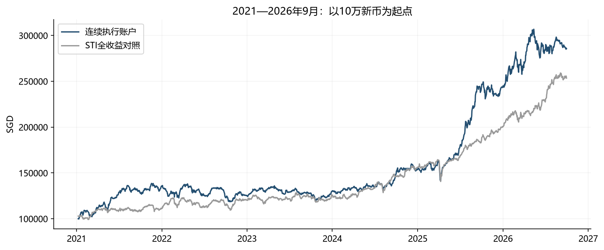
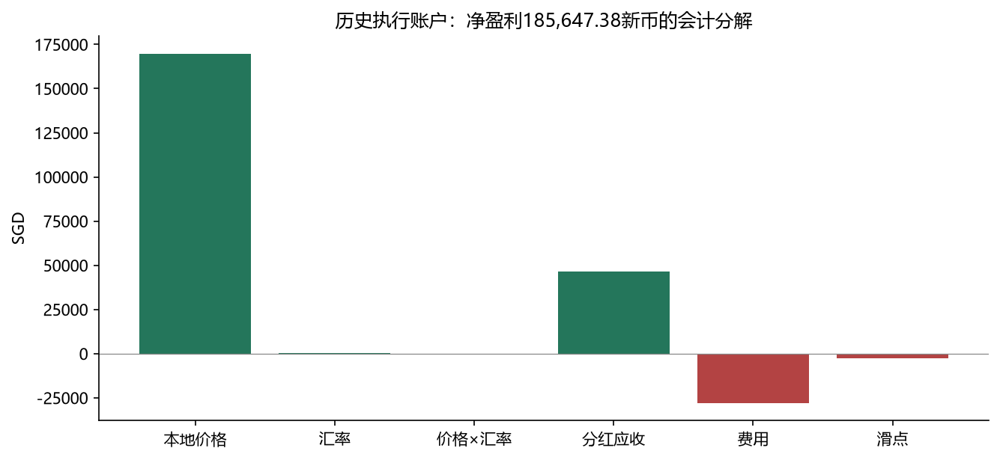
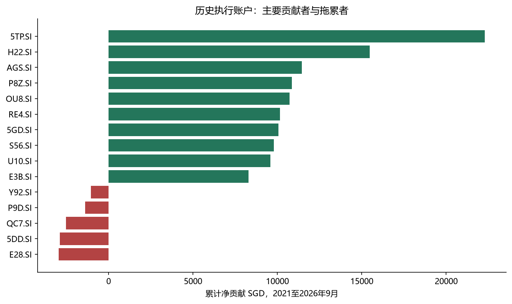
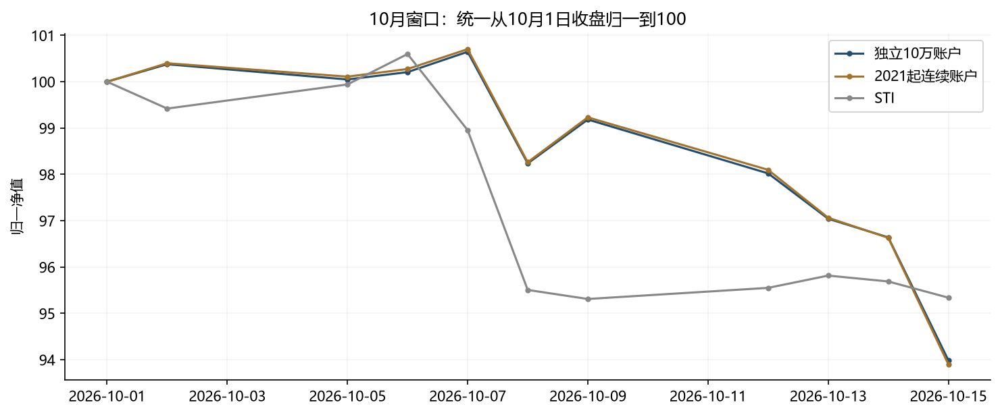
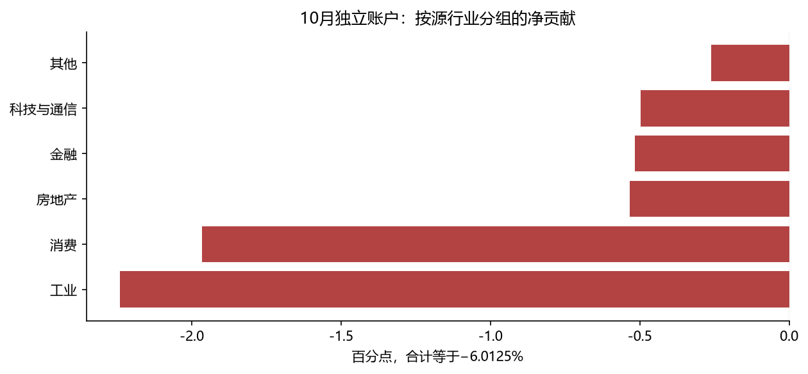
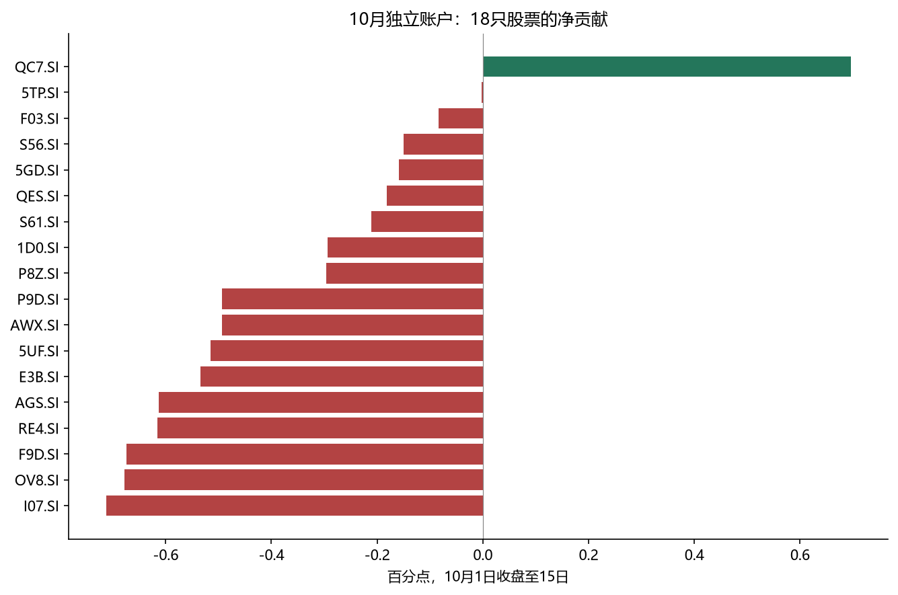
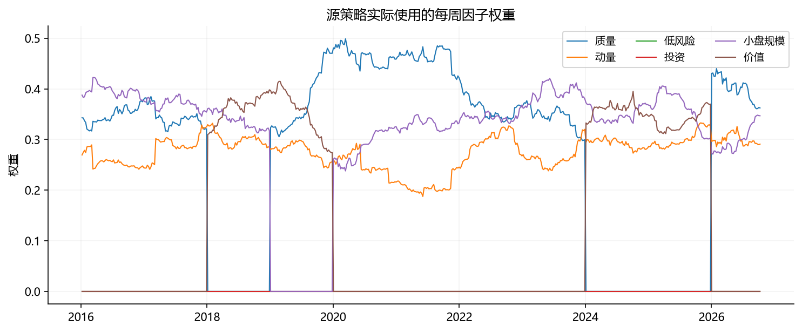
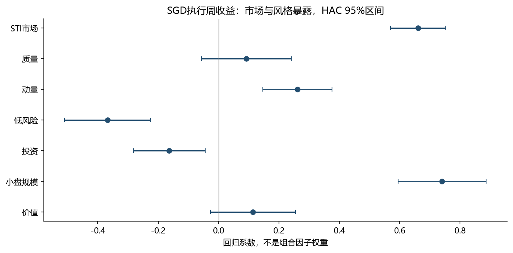

# 新加坡三因子策略业绩归因

2026-10-21　源版本 abf1c66ffd82　K3 / IV weekly / top20　币种：SGD执行账户

## 一、先明确：这次到底解释哪条收益曲线

最终研究对象：**K3_IV_weekly_top20**。年度选择三个风格，每周重估逆波动因子权重，股票取前20%并等权。归因直接承接组员两份Excel及新仓库 `abf1c66ffd82` 的持仓、成交、净值和成本，不沿用旧Top4业绩。

本报告解释已交付的模拟执行结果。分红14日支付、价格/股数单位、市场冲击等仍沿用源模型假设；未将其升级为已核实的券商实盘结果。源分红事件只到2026-09-15，10月“零分红”是源记录口径。行业结果沿用源研究分组，其中CNMC被标为科技与通信，与官方黄金开采主营不一致，详见第五节。

| 结果口径 | 起点净值 SGD | 终点净值 SGD | 累计收益 | 相对STI pp |
| --- | --- | --- | --- | --- |
| 历史执行账户：2021—2026/09 | 100,000.00 | 285,647.38 | 185.65% | +32.1685 |
| 10月独立账户：含首次建仓 | 100,000.00 | 93,782.47 | -6.22% | 不在此口径比较 |
| 10月独立账户：10/1收盘起 | 99,781.85 | 93,782.47 | -6.01% | -1.3515 |
| 10月连续账户：10/1收盘起 | 283,633.73 | 266,334.30 | -6.10% | -1.4382 |

历史执行账户的日历年化为**20.11%**，最大回撤14.36%。源周频研究回测的样本外年化为24.53%，是另一口径：本币远期复权收益、周频比例成本与历史目标持仓路径。不能把24.53%与20.11%的全部差额叫作交易费用。

10月独立账户与2021起连续账户的初始状态、现金、股数和最低佣金负担不同，因此相同策略可以有不同的窗口收益。10月1日到15日只有11个收盘净值、10个收盘到收盘收益观察，不用短窗年化数值判断长期能力。

## 二、三个仓库的定位与两份Excel的衔接

| 仓库/分支 | 核查结论 |
| --- | --- |
| 原仓库 EricLu/sg-adaptive-top4 | 仍为def5d53旧路线，不是这次结果的直接入口 |
| 原仓库 research/sg-single-factor-independent | 0608b8e，10/21更新；单因子研究有用，已被新项目纳入测试 |
| Cross-Market-Adaptive-Multi-Factor-Strategy | main仍为487f45c；另有既有框架/Investability分支，无本次K3完整交付 |
| 新仓库 FE5209-GroupProject/main | abf1c66ffd82；包含96只股票数据、汇率、K3代码与执行引擎，作为本次权威来源 |

原两个仓库已显式读取所有远端分支，避免单分支克隆漏检。初次分析对新仓库40个来源文件记录哈希并复核未改动。GitHub交付允许README/GUIDE增加归因导航，其余38个策略、配置与输入文件继续锁定哈希。工作簿原件保持不变。

配置排名表覆盖45种配置，K3/IV周/前20%在该表排第3；最终项目只比较K3、K4、EW及三种IV频率的24种配置，在这个集合中它排第1。两种排名范围不同，本报告按配置键衔接，不按行号衔接，也不重新选择最高收益策略。

18项工作簿对照中，**17项达到设定精度**，包括样本内与样本外指标、每日NAV、费用、滑点、47笔成交、18只持仓及完成率。另1项是STI数据微差：Excel为−4.661500%，当前仓库逐日指数算得−4.660983%，相差0.000517个百分点，超出6位小数正常舍入范围。没有改写它来强行对齐；本报告统一使用仓库逐日STI，故独立账户相对收益为−1.351519个百分点，Excel为−1.351001个百分点。

[核查版本](https://github.com/lu2548214469-bit/FE5209-GroupProject/tree/abf1c66ffd82b03c6183ff3546a5eb30749db934) · [策略配置](https://github.com/lu2548214469-bit/FE5209-GroupProject/tree/abf1c66ffd82b03c6183ff3546a5eb30749db934/config/strategy.yaml) · [执行配置](https://github.com/lu2548214469-bit/FE5209-GroupProject/tree/abf1c66ffd82b03c6183ff3546a5eb30749db934/config/execution.yaml) · [数据说明](https://github.com/lu2548214469-bit/FE5209-GroupProject/tree/abf1c66ffd82b03c6183ff3546a5eb30749db934/data/README.md)

## 三、归因方法：每一项贡献都必须加回净值

执行账户以新币记账，逐日逐股使用源引擎实际贡献：

```text
净贡献 = 股价损益 + 分红应收 − 费用 − 滑点
所有股票净贡献之和 = 期末净值 − 期初净值
期间贡献百分点 = 期间贡献金额 ÷ 该期间期初净值 × 100
```

除权日按此前持股确认分红应收，支付日只是应收转为现金，不再记一遍收益。T+2卖出款到账也不产生第二遍收益。跨期累计使用损益金额或明确的财富链接，不简单相加每日收益率，更不把各股票CAGR相加。

外币股票的价格损益进一步精确拆分：

```text
q × (P₁F₁ − P₀F₀)
= q × (P₁−P₀)F₀       本地价格
+ q × P₀(F₁−F₀)       汇率
+ q × (P₁−P₀)(F₁−F₀)  交互项
```

q是前日持股，P是本币价格，F是每单位外币对应的新币。缺失报价日沿用源引擎最后一次新币估值，不自行插入汇率收益。逐股价格拆分最大误差约1.23×10⁻¹²新币。

周频研究账户独立使用源w×远期收益，并把真实源成本差额单列。第t周贡献乘此前净财富后累加，因此股票与成本的总和精确等于累计净收益。输出中的百分点都是指定起点的累计贡献，不是年化百分点。

## 四、历史执行账户：185,647.38新币利润从哪里来





| 来源 | 贡献 SGD | 累计收益贡献 pp |
| --- | --- | --- |
| 本地价格 | 169,725.78 | +169.7258 |
| 汇率 | 388.99 | +0.3890 |
| 价格与汇率交互 | -18.97 | -0.0190 |
| 分红应收 | 46,268.76 | +46.2688 |
| 费用 | -27,937.43 | -27.9374 |
| 滑点 | -2,779.76 | -2.7798 |

累计收益185.6474%。本地价格是最大正贡献，分红应收贡献46,268.76新币；费用和滑点合计扣减30,717.18新币。这里的分红贡献是已发生在当前持仓路径中的会计贡献，不能据此宣称“删除分红后CAGR一定下降多少”，因为再投资会改变后续股数、交易和费用。

汇率及交互合计约370.01新币，整体影响较小。不能把历史超额收益主要归因于外汇。该结论仅解释源模型实际持有的外币证券，未核实分币种现金结算或真实换汇费用。

## 五、历史个股与行业贡献者



### 主要正贡献

| 代码 | 公司 | 行业 | 净贡献 SGD | 累计收益贡献 pp |
| --- | --- | --- | --- | --- |
| 5TP.SI | CNMC Goldmine Holdings Limited | 科技与通信 | 22,293.56 | +22.2936 |
| H22.SI | Hong Leong Asia Ltd. | 工业 | 15,466.31 | +15.4663 |
| AGS.SI | The Hour Glass Limited | 消费 | 11,447.38 | +11.4474 |
| P8Z.SI | Bumitama Agri Ltd. | 消费 | 10,864.67 | +10.8647 |
| OU8.SI | Centurion Corporation Limited | 房地产 | 10,728.97 | +10.7290 |
| RE4.SI | Geo Energy Resources Limited | 其他 | 10,148.82 | +10.1488 |
| 5GD.SI | Sunpower Group Ltd. | 其他 | 10,051.18 | +10.0512 |
| S56.SI | Samudera Shipping Line Ltd | 工业 | 9,782.52 | +9.7825 |
| U10.SI | UOB-Kay Hian Holdings Limited | 金融 | 9,585.23 | +9.5852 |
| E3B.SI | Wee Hur Holdings Ltd. | 房地产 | 8,282.08 | +8.2821 |

### 主要拖累

| 代码 | 公司 | 行业 | 净贡献 SGD | 累计收益贡献 pp |
| --- | --- | --- | --- | --- |
| Y92.SI | Thai Beverage Public Company Limited | 消费 | -1,039.56 | -1.0396 |
| P9D.SI | Civmec Limited | 工业 | -1,384.75 | -1.3848 |
| QC7.SI | Q & M Dental Group (Singapore) Limited | 其他 | -2,525.31 | -2.5253 |
| 5DD.SI | Micro-Mechanics (Holdings) Ltd. | 科技与通信 | -2,889.20 | -2.8892 |
| E28.SI | Frencken Group Limited | 科技与通信 | -2,954.08 | -2.9541 |

### 行业净贡献

| 行业 | 净贡献 SGD | 累计收益贡献 pp |
| --- | --- | --- |
| 工业 | 37,804.04 | +37.8040 |
| 消费 | 32,568.09 | +32.5681 |
| 房地产 | 32,477.81 | +32.4778 |
| 其他 | 31,808.34 | +31.8083 |
| 科技与通信 | 30,441.49 | +30.4415 |
| 金融 | 20,547.61 | +20.5476 |

CNMC、Hong Leong Asia、The Hour Glass、Bumitama与Centurion是历史主要贡献者。按源研究分组，工业贡献最高，六个分组均为正；这不是已认证标准行业分类下的结论。个股贡献取决于持仓规模、持有时间、交易与分红，不能用股票全样本涨幅替代。

**行业标签核查：**源security_master与周频面板都把CNMC（5TP）归入科技与通信，二者互相一致，但与[公司官方黄金勘探与开采主营](https://www.cnmc.com.hk/about_us.html)及[SGX资源板块说明](https://investorrelations.sgx.com/news-releases/news-release-details/cnmc-goldmine-lists-catalist-expanding-sgx-commodities-resource)不一致。尚需组员确认它是自定义分组还是映射问题。仅在展示层把CNMC从科技移到“其他”，历史科技贡献会由30,441.49降至8,147.93新币，“其他”由31,808.34升至54,101.90，行业排名也会改变；账户总收益和CNMC个股贡献不变。该敏感性没有重跑行业中性化分数或行业约束，不能称为修正分类后的策略回测。10月CNMC净贡献约−2.70新币，这一单项重分组不改变工业、消费为主要拖累的结论。没有据此认证其余所有行业标签。

## 六、年度表现：金额贡献与收益率分开阅读

| 期间 | 期初 SGD | 期末 SGD | 净损益 SGD | 期间收益 |
| --- | --- | --- | --- | --- |
| 2021 | 100,000.00 | 135,837.47 | 35,837.47 | 35.84% |
| 2022 | 135,837.47 | 125,467.02 | -10,370.45 | -7.63% |
| 2023 | 125,467.02 | 129,702.96 | 4,235.94 | 3.38% |
| 2024 | 129,702.96 | 153,518.36 | 23,815.40 | 18.36% |
| 2025 | 153,518.36 | 244,167.24 | 90,648.88 | 59.05% |
| 2026至9月 | 244,167.24 | 285,647.38 | 41,480.14 | 16.99% |

后期账户较大，同样百分比会带来更大的金额贡献。因此跨年比较应同时看金额和收益率。各年贡献明细已分别输出，2026年只到9月，不与完整年度直接比全年收益。

## 七、10月独立账户：亏损主要是价格，而非未成交







### 主要拖累

| 代码 | 公司 | 行业 | 净贡献 SGD | 累计收益贡献 pp |
| --- | --- | --- | --- | --- |
| AGS.SI | The Hour Glass Limited | 消费 | -611.14 | -0.6125 |
| RE4.SI | Geo Energy Resources Limited | 其他 | -614.52 | -0.6159 |
| F9D.SI | Boustead Singapore Limited | 工业 | -672.74 | -0.6742 |
| OV8.SI | Sheng Siong Group Ltd | 消费 | -676.85 | -0.6783 |
| I07.SI | ISDN Holdings Limited | 工业 | -711.10 | -0.7127 |

### 主要缓冲

| 代码 | 公司 | 行业 | 净贡献 SGD | 累计收益贡献 pp |
| --- | --- | --- | --- | --- |
| QC7.SI | Q & M Dental Group (Singapore) Limited | 其他 | 694.26 | +0.6958 |
| 5TP.SI | CNMC Goldmine Holdings Limited | 科技与通信 | -2.70 | -0.0027 |
| F03.SI | Food Empire Holdings Limited | 消费 | -84.00 | -0.0842 |

10月1日收盘至15日，净亏损5,999.39新币、收益−6.0125%。本地价格损失5,837.50，后续费用149.83、滑点12.06；价格贡献−5.8503个百分点，费用及滑点约−0.1622个百分点。工业−2.2410个百分点、消费−1.9647个百分点，合计约占净亏损70%。

ISDN、Sheng Siong、Boustead、Geo Energy和The Hour Glass是主要拖累。Q&M贡献约+0.6958个百分点，是最明显的正缓冲。历史最大贡献者CNMC在这个短窗接近平价，说明长期赢家不保证每个窗口都能抵消其他持仓的损失。

共有47笔模拟成交，订单数量完成率100%，10月15日现金约3.5044%。不能用未成交解释这次主要亏损；也不能把“模型全部完成”当作券商真实成交证明。当前18只持仓均以SGD报价，本窗口汇率贡献为零。

## 八、为什么−6.2175%、−6.0125%、−6.0992%和−6.1880%都出现了

| 结果口径 | 起点净值 SGD | 终点净值 SGD | 累计收益 | 相对STI pp |
| --- | --- | --- | --- | --- |
| 10月独立账户：含首次建仓 | 100,000.00 | 93,782.47 | -6.22% | 不在此口径比较 |
| 10月独立账户：10/1收盘起 | 99,781.85 | 93,782.47 | -6.01% | -1.3515 |
| 10月连续账户：10/1收盘起 | 283,633.73 | 266,334.30 | -6.10% | -1.4382 |

**现金起点与收盘起点：**10万现金在10月1日建仓后，收盘NAV为99,781.854998。首次建仓费用约126.64、滑点91.51，合计218.15新币。因此现金起点收益−6.2175%额外包含这笔建仓成本；收盘到收盘收益−6.0125%排除它。二者分母也不同，不是简单减0.21815个百分点。

**独立与连续账户：**连续账户10月1日收盘NAV为283,633.73，10月15日为266,334.30，窗口收益−6.0992%。其股数、现金、应收和最低费用相对规模与新建10万账户不同。不能把两个账户的个股金额混在一起。

**周频研究延伸：**配置排名表的−6.1880%来自源理论日净值，含首日比例建仓费用，且不受股数、最低佣金、交收与成交量约束。它用于对应源研究结果，不是24策略工作簿的股数现金账户收益。

## 九、相对STI：把现金缓冲单独解释

统一使用仓库逐日STI后，10月独立账户相对收益为**-1.3515个百分点**。我们对每一天的实际期初股票权重减去同权重的STI收益，再加现金及应收相对STI的效果，并进行财富链接。

```text
股票净相对贡献 -1.4929 pp
现金及应收缓冲 +0.1413 pp
合计相对STI     -1.3515 pp
```

现金本身在模型里没有利息收入。正的相对贡献表示市场下跌时，未投资现金少承受了一部分跌幅，不是现金实际赚取了相同金额。历史上涨窗口则相反：现金及应收的相对效果约−15.5038个累计百分点，部分抵消股票相对效果+47.6724个百分点，剩余约+32.1685个百分点。

这是以总体STI收益为门槛的实际暴露分解，**不是STI行业Brinson归因**。仓库没有历史STI行业权重和行业收益，不能把行业净贡献直接叫作行业配置能力。

## 十、行业配置还是行业内选股：相对等权股票池的补充分析

源项目已有等权可投资股票池基准，可从同一周的股票、源行业分组和收益构造基准权重。我们在**源周频本币收益及原研究分组口径**下做Brinson-Fachler分解；它不替代SGD执行账户，也不冒充相对STI的行业归因。CNMC等分组的经济含义未全部认证，因此下面配置/选股项也受源分类影响。

| 效果 | 累计贡献 pp |
| --- | --- |
| 行业配置 | +10.7962 |
| 行业内选股 | +173.2578 |
| 交互 | -20.6869 |
| 源交易成本 | -4.5491 |
| 合计超额 | +158.8181 |

该口径中，行业内选股项远大于行业配置项，负交互项抵消部分收益。可解释为“相对源等权股票池，行业内持仓选择贡献较多”；不能据此断言相对STI的选股alpha已获证明。

```text
Aᵢ = (wᵢ−bᵢ)(Rᵦᵢ−Rᵦ)
Sᵢ = bᵢ(Rₚᵢ−Rᵦᵢ)
Iᵢ = (wᵢ−bᵢ)(Rₚᵢ−Rᵦᵢ)
```

现金也作为一个类别，源净收益与毛收益的差额单列成本。没有组合持仓的行业用该行业基准收益作中性补全，使选股及交互项不凭空出现。跨周链接系数为“此前策略净财富×该周之后的基准增长”，各项精确加回策略与基准期末财富之差。

## 十一、三个因子如何作用：信号解释不能冒充损益分摊



| 年份 | 当年入选因子 |
| --- | --- |
| 2016 | Momentum, Quality, Size |
| 2017 | Momentum, Quality, Size |
| 2018 | Momentum, Size, Value |
| 2019 | Momentum, Quality, Value |
| 2020 | Quality, Momentum, Size |
| 2021 | Quality, Size, Momentum |
| 2022 | Size, Quality, Momentum |
| 2023 | Momentum, Size, Quality |
| 2024 | Momentum, Size, Value |
| 2025 | Value, Momentum, Size |
| 2026 | Size, Momentum, Quality |

| 信号日 | 质量 | 动量 | 小盘规模 |
| --- | --- | --- | --- |
| 2026-09-25 | 36.11% | 29.08% | 34.81% |
| 2026-10-02 | 36.32% | 28.97% | 34.71% |
| 2026-10-09 | 36.22% | 29.09% | 34.69% |

三因子指每年选择三个风格，并非三只股票，也不是固定永远选择同三个风格。2026年为规模、动量、质量。10月窗口信号中，质量约36%、规模约35%、动量约29%；股票本身仍按目标股数规模对应的等权目标执行。

我们通过只记录返回值、随后恢复函数的观察包装，重跑未修改的源策略，捕获真实每周IV权重；验证其加权分数逐股加回源composite_score。没有用年度表里四舍五入的初始权重代替整年的周权重。

Top20%、保留缓冲和行业上限使股票选择非线性，因此不能说“质量36%就贡献36%的收益”。输出的因子分数分量解释排序；因子模拟多空篮子仅作诊断，不加进真实账户贡献总和。

三次10月目标都是同一组18只股票、相同等权目标。周IV权重确实略有变化，但没有改变入选集合。这解释了工作簿中周IV与月IV前20%结果一致，短窗相同不等于规则没有执行。

## 十二、市场与风格风险回归：小盘和动量暴露突出



| 项 | 系数 | HAC统计量 | 双侧p值 |
| --- | --- | --- | --- |
| alpha | -0.0014 | -2.507 | 0.01216 |
| STI市场 | +0.6607 | +14.067 | 6.045e-45 |
| 质量 | +0.0919 | +1.206 | 0.2279 |
| 动量 | +0.2611 | +4.484 | 7.319e-06 |
| 低风险 | -0.3670 | -5.045 | 4.525e-07 |
| 投资 | -0.1634 | -2.689 | 0.007174 |
| 小盘规模 | +0.7403 | +9.932 | 3.012e-23 |
| 价值 | +0.1138 | +1.586 | 0.1128 |

使用298个完整周，将执行账户收益与STI和六个因子模拟收益全部统一为SGD，并使用同一执行日至下一执行日。风格模拟收益由原股票池、原分数、同样前后30%构造，只用于解释；不反馈到原策略的因子选择。因子是可交易性未经验证的多空研究组合。

单市场模型beta约0.710、R²约28.7%，年化算术alpha约+7.79%，HAC p约0.187，不能说有显著正alpha。加入六风格后R²约82.3%，规模暴露约0.740、动量约0.261；低风险暴露约−0.367，说明即使没有显式选择低风险因子，也可能间接偏向高波动股票。

七因子解释模型的年化算术alpha约−7.36%，p约0.012。这表示相对当前市场/风格代理组合仍有负的未解释均值；可能涉及长多约束、现金、交易费用、风格代理与持仓构造差异。它不是“策略绝对收益为负”，也不自动识别某个因子导致了损失。

这里使用组合及市场总收益，没有扣除无风险利率。因此表中的alpha严格说是这一总收益回归的截距，不是已按无风险利率调整的Jensen alpha；其显著性也不能作为正式资产定价检验结论。

R²是周收益变动的样本内解释程度，不是利润的82.3%。回归系数不是组合权重，alpha×52是算术年化均值，不是CAGR。HAC采用Bartlett权重、4阶滞后及n/(n−k)修正，p值用渐近正态近似；这些是描述性回归，不构成因果或前瞻预测证据。

## 十三、最大回撤与短窗下跌集中度

独立账户在2026-10-07收盘达到峰值100,426.49，在2026-10-15收盘降至93,782.47，最大回撤6.62%。回撤归因以峰值净值为分母、峰值后至谷值的实际损益为分子，与10月1日起点的贡献不同。

| 代码 | 公司 | 峰谷净损益 SGD | 回撤贡献 pp |
| --- | --- | --- | --- |
| AWX.SI | AEM Holdings Ltd. | -952.5102 | -0.9485 |
| I07.SI | ISDN Holdings Limited | -838.7500 | -0.8352 |
| F9D.SI | Boustead Singapore Limited | -669.2435 | -0.6664 |
| OV8.SI | Sheng Siong Group Ltd | -587.4005 | -0.5849 |
| P8Z.SI | Bumitama Agri Ltd. | -559.2701 | -0.5569 |
| P9D.SI | Civmec Limited | -533.2113 | -0.5309 |

账户回撤不等于每只股票回撤的平均。持股数量、入场时点和现金会改变贡献；因此我们按峰谷窗口重新汇总贡献，而不是把全窗口个股损失直接当成回撤贡献。

## 十四、仍然存在的限制：哪些已查清，哪些没有

- **10月公司行动覆盖未认证。**事件源止于9月15日，故10月记零是源记录结果；如果实际有除息、配股等遗漏，相关净值和归因应重算。当前没有用推测填补。

- **价格与股数历史单位。**源价格已作拆股调整，保留源股数单位和100股整手假设，未认证为每个历史日期的真实不复权交易单位；不重复应用拆股表。

- **周频与执行币种不同。**源forward_return是上市币种收益，SGD执行账户包含FX；周频行业与个股结论限定在原口径，不把它当SGD实盘总回报。

- **源未来持有期标签。**最新周的next_execution_date为10月19日，而日行情只到10月15日；本报告不把这类未完成周用于周频业绩或风险回归。10月采用已观察到的逐日账户。

- **最近四周资格标志。**清洗说明将price_eligible空值按合格处理，需要数据团队确认含义；本报告承接此选择，没有自行换股票池。

- **PIT与历史股票池。**年报滞后183天、修订版本、历史成员及退市覆盖仍未独立核验。通过源代码的时间顺序测试不代表所有输入满足PIT。

- **成交是代理。**日收盘价和全日量上限不能证明收盘时可成交，盘口、价差、排队和规模冲击未校准。FX换汇与结算也采用源模型简化。

- **目标冻结与实际持仓。**执行账户承接源策略的目标和保留缓冲路径；未成交不触发重新选股。按源结果归因有效，但不能宣称闭环实盘组合与它完全相同。

- **基准不足。**没有历史STI行业成分权重与行业收益，因此不做STI行业配置/选股Brinson分解。EW股票池补充分析及STI整体门槛分析均有单独标签。

- **选择偏差与时间证据。**按项目定义区分2016—20选择期、2021—26评估期、10月测试期；未独立审计所有实验日志和“选定前未看后期数据”的时间证据。10月样本很短，不以短窗排名重选策略。

- **基准微差保留。**工作簿STI与仓库逐日值有0.000517个百分点差异，源组合NAV全部按原数保留，超额结果统一使用当前逐日基准。

- **源行业标签未认证。**已确认CNMC源科技标签与官方资源业务不一致；仅展示重分类敏感性，未改源策略。它可能同时影响上游行业中性化及行业持仓上限，应由数据组确认原始映射。

## 十五、可以在汇报中说什么

> 我们严格承接最新K3、每周IV因子调权、前20%选股配置，并复现两份Excel中该策略的净值与交易结果。历史执行账户的收益主要来自本地价格上涨及分红，CNMC、Hong Leong Asia等是主要贡献者；10月独立账户的亏损则主要集中于工业、消费及ISDN等持仓。订单在模型中全部完成，因此不能主要归因于未成交。风格回归显示明显小盘与动量暴露，但不能宣称有稳定且独立于风格的正alpha。所有贡献都核对回净值，因子信号贡献和实际盈利贡献分开呈现。

### 常见提问

**三因子是不是三只股票？**

不是。三个风格用于评分，当前窗口目标持有18只股票。

**周调权为何与月调权同收益？**

三次调仓的最终18只股票及等权目标相同，小幅因子权重变化没有跨过选股边界。

**成交率100%为什么还亏？**

完成订单只是实现持仓，股票随后下跌仍会亏损。模型成交也不等于真实券商成交。

**能说历史战胜STI吗？**

在源执行模型及相同窗口下，历史累计相对收益为正；10月则落后。不能把这直接等同于显著、稳定的选股alpha。

**手续费是不是24.53%降到20.11%的全部原因？**

不能。两个系列在币种、日期、初始化、分红再投资和执行约束上都有差异。

**行业净贡献就是行业配置能力吗？**

不是。净贡献没有扣除行业基准收益；STI行业数据缺失，不能强行拆分。

**质量权重36%是否解释36%的利润？**

不能。股票选择非线性，因子权重只解释评分。损益必须从实际持股和价格变化计算。

**分红为零已经查实了吗？**

只查实源文件窗口内无记录，真实10月事件完整性仍待确认。

## 十六、复核和交付内容

源执行测试31项通过（30项合成、1项真实数据整合）；新增归因恒等式4项通过。两份Excel对照18项，17项精确或在既定精度内通过，STI微差单列。股票、行业、币种、现金、成本和峰谷回撤均回勾净值；策略、输入与原Excel未修改。

- `results/`：账户窗口、逐股逐日、行业、币种、费用、回撤、周频链接、因子权重及HAC回归CSV。

- `source_audit/`：工作簿缓存值与公式记录、三个仓库版本、源输入与代码哈希。

- `reproduced_main/`：未修改源项目的完整复现输出。

- `reproduced_fresh_live/`：与24策略Excel同初始化的独立账户输出。

- `report/figures/`：8张可直接用于汇报的图。

复现顺序：原仓库主程序→attribution_engine.py→sector_attribution.py→active_attribution.py→sector_label_audit.py→归因测试→build_report.py→verify_delivery.py。具体步骤见包内README_ZH.md。本版本为用户授权的GitHub归因交付，新增归因结果及文档，源策略和输入数据保持不变。

## 方法参考

会计恒等式和财富链接在本报告中明确列出。方法定位参考：
[CFA Institute：Performance Attribution: History and Progress](https://rpc.cfainstitute.org/research/foundation/2019/performance-attribution)；
[CFA Institute：Portfolio Performance Evaluation](https://www.cfainstitute.org/insights/professional-learning/refresher-readings/2026/portfolio-performance-evaluation)；
[statsmodels：Newey–West HAC与Bartlett权重](https://www.statsmodels.org/stable/generated/statsmodels.stats.sandwich_covariance.cov_hac.html)。以上为方法参考，行情、持仓和回测数字均来自本次锁定的项目与工作簿。
